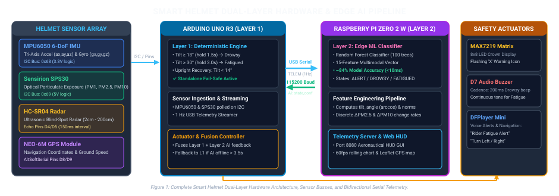
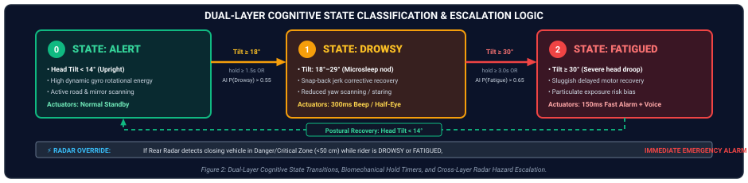
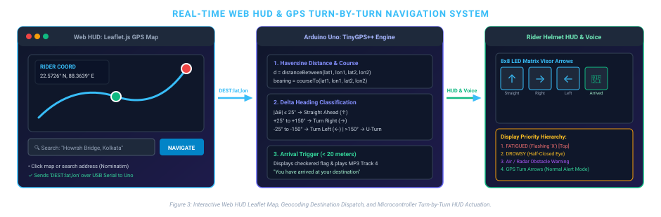
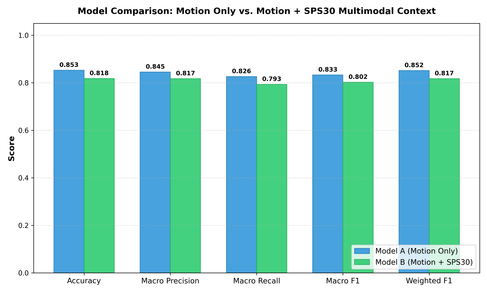
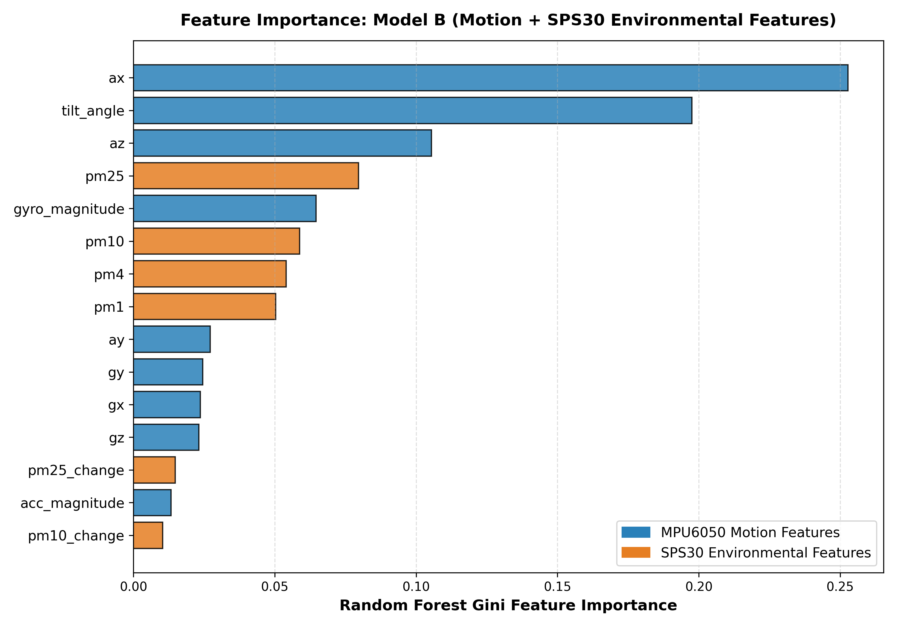
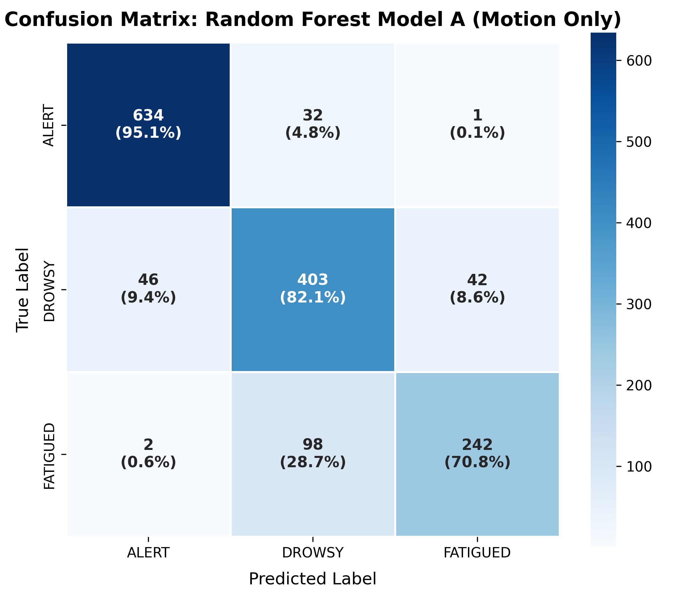

# 🛡️ AI-Integrated Smart Helmet System
### Dual-Layer Rider Fatigue Detection, Particulate Exposure Analytics & Real-Time GPS HUD

[](https://www.python.org/)
[](https://www.arduino.cc/)
[](https://www.raspberrypi.com/)
[](https://scikit-learn.org/)
[](https://leafletjs.com/)
[]()
[](https://opensource.org/licenses/MIT)

---

> [!WARNING]
> **SCIENTIFIC & MEDICAL DISCLAIMER:**
> This system is an algorithmic research and prototyping framework designed for embedded proof-of-concept testing, machine learning benchmarking, and edge IoT pipeline development. It is **NOT** a certified medical diagnostic device. The Sensirion SPS30 optical particulate matter sensor serves as an **environmental/micro-climate contextual sensor**, not a direct biological detector of fatigue. Synthetic datasets are purely simulated for algorithm development and must not be cited as clinical human trials.

---

## 📑 Table of Contents
1. [Executive Summary & Problem Statement](#1-executive-summary--problem-statement)
2. [End-to-End System Architecture](#2-end-to-end-system-architecture)
   - [The Two-Layer Philosophy](#the-two-layer-philosophy)
   - [Hardware & Edge AI Architecture Diagram](#hardware--edge-ai-architecture-diagram)
   - [Bidirectional USB Serial Protocol](#bidirectional-usb-serial-protocol)
3. [Dual-Layer Cognitive Decision Engine](#3-dual-layer-cognitive-decision-engine)
   - [Cognitive States](#cognitive-states)
   - [Decision Flowchart & Escalation Logic](#decision-flowchart--escalation-logic)
   - [Decision Fusion Matrix & Truth Table](#decision-fusion-matrix--truth-table)
   - [Watchdog Fail-Safe Mechanism](#watchdog-fail-safe-mechanism)
4. [Sensor Suite & Physical Principles](#4-sensor-suite--physical-principles)
   - [MPU6050 6-DoF Inertial Measurement Unit](#1-mpu6050-6-dof-inertial-measurement-unit)
   - [Sensirion SPS30 Optical Particulate Sensor](#2-sensirion-sps30-optical-particulate-sensor)
   - [HC-SR04 Ultrasonic Blind-Spot Radar](#3-hc-sr04-ultrasonic-blind-spot-radar)
   - [NEO-6M GPS & TinyGPS++ Engine](#4-neo-6m-gps--tinygps-engine)
   - [Multi-Modal Actuators (Matrix, Buzzer, DFPlayer Voice)](#5-multi-modal-safety-actuators)
5. [Interactive Web HUD & Navigation Dashboard](#5-interactive-web-hud--navigation-dashboard)
   - [Aeronautical / Cyberpunk HUD Aesthetics](#aeronautical--cyberpunk-hud-aesthetics)
   - [Real-Time Leaflet GPS Navigation & Geocoding](#real-time-leaflet-gps-navigation--geocoding)
   - [Architecture Diagram: HUD & Dispatch](#architecture-diagram-hud--dispatch)
6. [Machine Learning Pipeline & Empirical Research](#6-machine-learning-pipeline--empirical-research)
   - [Synthetic Data Generation Methodology](#synthetic-data-generation-methodology)
   - [Session-Grouped Stratified Splitting](#session-grouped-stratified-splitting)
   - [The Research Hypothesis: Role of SPS30](#the-research-hypothesis-role-of-sps30)
   - [Model Comparison: Motion Only vs. Motion + SPS30](#model-comparison-motion-only-vs-motion--sps30)
   - [Feature Importance Analysis](#feature-importance-analysis)
   - [Confusion Matrices](#confusion-matrices)
7. [Hardware Wiring & Pinout Topology](#7-hardware-wiring--pinout-topology)
8. [Installation, Deployment & Quickstart Guide](#8-installation-deployment--quickstart-guide)
   - [Prerequisites](#prerequisites)
   - [Step 1: Dataset Generation](#step-1-dataset-generation)
   - [Step 2: Model Training](#step-2-model-training)
   - [Step 3: Real-Time CLI Inference](#step-3-real-time-cli-inference)
   - [Step 4: Microcontroller Firmware Flashing](#step-4-microcontroller-firmware-flashing)
   - [Step 5: Launching the Web HUD & GPS Navigation](#step-5-launching-the-web-hud--gps-navigation)
   - [Step 6: Deploying to Raspberry Pi via Network Sync](#step-6-deploying-to-raspberry-pi-via-network-sync)
9. [Repository File Structure](#9-repository-file-structure)
10. [Technical Specifications & Edge Performance](#10-technical-specifications--edge-performance)
11. [License](#11-license)

---

## 1. Executive Summary & Problem Statement

Motorcyclists face some of the highest fatality rates in urban and highway transit. Among contributing factors, **rider fatigue, drowsiness, and microsleep episodes** are uniquely hazardous: unlike automobile drivers who may drift across lanes with physical chassis protection, an unconscious or hypovigilant two-wheeler rider loses dynamic gyroscopic stability, risking catastrophic falls in fractions of a second.

Furthermore, long-distance riders endure severe **environmental stressors**—specifically toxic airborne particulate matter ($PM_{1.0}$, $PM_{2.5}$, $PM_{10}$), diesel soot, and road dust—which aggravate ocular dryness, breathing strain, and cognitive exhaustion.

The **AI-Integrated Smart Helmet** addresses this challenge through a unified, edge-computing cyber-physical system featuring:
- **Dual-Layer Cognitive State Estimation:** A hard real-time deterministic biomechanical reflex on an Arduino Uno coupled with a 15-dimensional Random Forest classifier running on a Raspberry Pi Zero 2 W.
- **Multimodal Environmental Sensing:** Continuous optical aerosol spectrometry (Sensirion SPS30) monitoring particulate exposure.
- **Rear Blind-Spot Radar:** Continuous ultrasonic monitoring (HC-SR04) with cross-layer emergency escalation if a vehicle tailgates a fatigued rider.
- **Visor HUD & Voice Prompts:** 8x8 LED matrix display, multi-frequency acoustic alarm, and DFPlayer Mini spoken alerts.
- **Turn-by-Turn GPS Navigation & Web HUD:** Interactive Leaflet.js telemetry server with real-time geocoding destination dispatch.

---

## 2. End-to-End System Architecture

### The Two-Layer Philosophy

In safety-critical IoT applications, relying solely on an operating-system-based edge computer (e.g., Linux on Raspberry Pi) introduces vulnerabilities: Linux kernel scheduling delays, Python garbage collection pauses, or SD-card reboot cycles could blind the system during critical microsleep events. Conversely, an 8-bit microcontroller (Arduino Uno ATmega328P) lacks the floating-point throughput and RAM to evaluate complex machine learning decision ensembles.

To resolve this trade-off, this system implements a **Dual-Layer Division of Labor**:

1. **Layer 1: Deterministic Biomechanical Reflex (Arduino Uno R3)**
   - Hard real-time execution with zero operating system overhead.
   - Directly samples the MPU6050 (6-DoF IMU) and SPS30 via hardware I2C bus.
   - Calculates dynamic 3D tilt vectors against an initial calibrated gravity baseline.
   - Enforces time-held persistence thresholds (e.g., $18^\circ$ for 1.5s $\to$ Drowsy, $30^\circ$ for 3.0s $\to$ Fatigued).
   - Functions as an autonomous, un-brickable fail-safe if the upstream AI computer disconnects.
   - Directly drives all physical actuators (MAX7219 matrix, Piezo buzzer, DFPlayer Mini).

2. **Layer 2: Edge Machine Learning Inference (Raspberry Pi Zero 2 W)**
   - Receives continuous 1 Hz telemetry packets over USB Serial at 115,200 baud.
   - Evaluates a 15-dimensional feature vector using a trained **Random Forest Classifier (100 estimators)**.
   - Captures subtle, high-frequency kinetic signatures (tremors, angular roll velocities, erratic micro-nodding) that simple geometric thresholding cannot identify.
   - Transmits predicted cognitive states and confidence probabilities back to the Arduino.
   - Hosts the interactive Aeronautical Web HUD and Leaflet.js GPS map server.

### Hardware & Edge AI Architecture Diagram



### Bidirectional USB Serial Protocol

Communication between the Arduino Uno and Raspberry Pi occurs over a robust, ASCII-delimited serial link (115200 baud, 8N1):

```text
 ┌──────────────────────────────────────────────────────────────┐
 │                     ARDUINO UNO R3                           │
 │  - Reads MPU6050, SPS30, HC-SR04, NEO-6M GPS                 │
 │  - Evaluates Layer 1 Deterministic Threshold Engine          │
 └──────────────────────────────┬───────────────────────────────┘
                                │
          TELEM:ax,ay,az,gx,gy,gz,tilt,pm1,pm25,pm4,pm10,
                threshState,gpsFix,lat,lon,speed,sats,navDist,navDir
                                │  (USB Serial @ 115200 baud, 1 Hz)
                                ▼
 ┌──────────────────────────────────────────────────────────────┐
 │                  RASPBERRY PI ZERO 2 W                       │
 │  - Script: rpi_arduino_bridge.py / dashboard_server.py       │
 │  - Runs Layer 2: 15-Feature Random Forest ML Model           │
 │  - Serves Real-Time Leaflet.js Web HUD on Port 8080          │
 └──────────────────────────────┬───────────────────────────────┘
                                │
                          AI:state,conf
                                │  (USB Serial @ 115200 baud)
                                ▼
 ┌──────────────────────────────────────────────────────────────┐
 │                FINAL DECISION FUSION LAYER                   │
 │                (Embedded in Arduino Uno)                     │
 │  - Fuses Layer 1 + Layer 2 with Priority Override Rules      │
 │  - Controls MAX7219 Matrix, Buzzer & DFPlayer Voice Prompts  │
 │  - Automatic Fallback to Layer 1 if USB or Pi Disconnects    │
 └──────────────────────────────────────────────────────────────┘
```

#### 1. Telemetry Upstream Packet (Arduino $\to$ Pi)
```
TELEM:<ax>,<ay>,<az>,<gx>,<gy>,<gz>,<tilt>,<pm1>,<pm25>,<pm4>,<pm10>,<threshState>,<gpsFix>,<lat>,<lon>,<speed>,<sats>,<navDist>,<navDir>
```
*Example:*
```
TELEM:-0.42,0.18,9.75,1.20,-0.85,0.40,12.4,14,22,29,35,0,1,22.572646,88.363895,34.2,8,420,1
```

#### 2. AI Inference Downstream Packet (Pi $\to$ Arduino)
```
AI:<predicted_state>,<confidence>
```
*Example:*
```
AI:1,0.842
```
*(State: `0` = ALERT, `1` = DROWSY, `2` = FATIGUED)*

#### 3. GPS Navigation Dispatch Downstream Packet (Web HUD $\to$ Arduino)
```
DEST:<latitude>,<longitude>
```
*Example:*
```
DEST:22.585120,88.346800
```

---

## 3. Dual-Layer Cognitive Decision Engine

### Cognitive States

The pipeline classifies the rider into one of three distinct vigilance states:

| State ID | Label | Biomechanical Manifestation | Dynamic Signature |
|---|---|---|---|
| **0** | **`ALERT`** | Upright head posture (tilt $< 14^\circ$). | Active mirror checking, dynamic yaw rotation, sharp posture recovery. |
| **1** | **`DROWSY`** | Forward or lateral drooping ($18^\circ \le \text{tilt} < 30^\circ$, held $\ge 1.5\text{ s}$). | Reduced yaw scanning (staring), episodic nodding with rapid startle/jerk recovery. |
| **2** | **`FATIGUED`** | Severe sagging head droop ($\text{tilt} \ge 30^\circ$, held $\ge 3.0\text{ s}$). | Sluggish motor control, delayed head recovery, drifting rotational trajectory. |

### Decision Flowchart & Escalation Logic



### Decision Fusion Matrix & Truth Table

The final cognitive assessment is computed using safety-weighted fusion logic executed on the Arduino:

```mermaid
flowchart TD
    subgraph Inputs
        L1[Layer 1: Physical Tilt Hold Timer]
        L2[Layer 2: Random Forest AI Classifier]
    end

    subgraph Decision Fusion Logic
        C1{L1 == FATIGUED OR\n(L2 == FATIGUED and Conf >= 0.65)?}
        C2{L1 == DROWSY OR\n(L2 == DROWSY and Conf >= 0.55) OR\nL2 == FATIGUED?}
        S0[STATE: ALERT\nDisplay: GPS Turn Arrows / Standby\nAudio: Silent]
        S1[STATE: DROWSY\nDisplay: Half-Droop Eye Alert\nAudio: 300ms Pulsed Buzzer + Voice Track 6]
        S2[STATE: FATIGUED\nDisplay: Rapid Flashing X\nAudio: 150ms Emergency Tone + Voice Track 7]
    end

    L1 --> C1
    L2 --> C1
    C1 -- YES --> S2
    C1 -- NO --> C2
    C2 -- YES --> S1
    C2 -- NO --> S0
```

#### Detailed Fusion Rules:
1. **Critical Fatigue Override:** If the rider exhibits severe head tilt ($\ge 30^\circ$ for $\ge 3.0\text{ s}$) **OR** the Random Forest model detects severe fatigue with $\ge 65\%$ confidence, `finalDecisionState` escalates immediately to **`FATIGUED`**.
2. **Drowsiness Warning:** If the rider exhibits moderate nodding ($\ge 18^\circ$ for $\ge 1.5\text{ s}$) **OR** the AI model classifies drowsiness with $\ge 55\%$ confidence, `finalDecisionState` becomes **`DROWSY`**.
3. **Attentive Recovery:** Both layers must confirm an upright posture (tilt $< 14^\circ$) and nominal kinematic activity to return to **`ALERT`**.
4. **Radar Cross-Intervention:** If the HC-SR04 rear ultrasonic radar detects a closing vehicle in the Danger or Critical zone ($< 50\text{ cm}$) while the rider is either `DROWSY` or `FATIGUED`, the system triggers an emergency override alert to prevent rear-end collisions.

### Watchdog Fail-Safe Mechanism

The Arduino firmware monitors incoming AI packets via a software timer (`millis() - lastAIRecvTime`). If no valid `AI:...` packet is received within **3500 ms** (due to cable disconnection, Pi power cycling, or software crash), the system prints a serial warning and **automatically falls back to Layer 1 threshold sensing**. The rider remains 100% protected by the physical tilt engine without system interruption.

---

## 4. Sensor Suite & Physical Principles

### 1. MPU6050 6-DoF Inertial Measurement Unit
Mounted rigidly inside the crown of the helmet:
- **Tri-Axis Accelerometer ($a_x, a_y, a_z$):** Measures total acceleration (gravity + dynamic acceleration). Dynamic range: $\pm 8\text{ g}$.
- **Tri-Axis Gyroscope ($g_x, g_y, g_z$):** Measures angular velocity in $^\circ/\text{s}$ across pitch (nodding), roll (lateral tilt), and yaw (mirror checks). Dynamic range: $\pm 500^\circ/\text{s}$.
- **Hardware Low-Pass Filter:** On-chip digital filter set to 21 Hz bandwidth to attenuate high-frequency motorcycle engine rumble while preserving human head kinematic dynamics.
- **Dynamic 4-Second Startup Calibration:** During the initial 4 seconds after boot, the Arduino computes the neutral resting gravity baseline vector $\vec{a}_{\text{ref}} = [refAX, refAY, refAZ]$.
- **Tilt Angle Computation:**
  $$\theta = \arccos\left(\text{clip}\left(\frac{\vec{a} \cdot \vec{a}_{\text{ref}}}{\|\vec{a}\| \|\vec{a}_{\text{ref}}\|}, -1.0, 1.0\right)\right) \times \frac{180}{\pi}$$

### 2. Sensirion SPS30 Optical Particulate Sensor
Mounted in the helmet's chin-bar airflow intake channel:
- **Measurement Technology:** Advanced laser scattering spectrometry utilizing Sensirion's proprietary dust-resistance technology.
- **Channels:** Mass concentration of $PM_{1.0}$, $PM_{2.5}$, $PM_{4.0}$, and $PM_{10.0}$ ($\mu g/m^3$).
- **Dynamic Rate of Change:** Discrete first-order differences:
  $$\Delta PM_{2.5} = PM_{2.5}(t) - PM_{2.5}(t-1)$$
  $$\Delta PM_{10} = PM_{10}(t) - PM_{10}(t-1)$$
- **I2C Clock Stretching Protection:** Configured with `Wire.setWireTimeout(25000, true)` on the Arduino Uno to prevent SPS30 fan-motor bus arbitration delays from hanging the main loop.

### 3. HC-SR04 Ultrasonic Blind-Spot Radar
Mounted facing rearward under the helmet's base rim:
- **Operating Principle:** High-frequency 40 kHz ultrasonic pulse burst ($d = \frac{t \times 0.0343}{2}\text{ cm}$).
- **Sampling Interval:** Polled every 150 ms using a non-blocking timeout of 25,000 $\mu s$ (max 4.0 m range).
- **Proximity Safety Zones:**
  - **Zone 0 (Clear):** $> 200\text{ cm}$
  - **Zone 1 (Caution):** $100\text{ cm} - 200\text{ cm}$ (Single 200ms periodic beep)
  - **Zone 2 (Warning):** $50\text{ cm} - 100\text{ cm}$ (Double 150ms warning beeps)
  - **Zone 3 (Danger):** $30\text{ cm} - 50\text{ cm}$ (Rapid 250ms cadence)
  - **Zone 4 (Critical):** $\le 30\text{ cm}$ (Continuous high-frequency 100ms alarm)

### 4. NEO-6M GPS & TinyGPS++ Engine
Connected via `AltSoftSerial` (Pin 8 RX, Pin 9 TX at 9600 baud):
- **Telemetry Extraction:** Latitude, Longitude, Ground Speed (km/h), Satellite Count, and Timestamp.
- **Great-Circle Haversine Formula:** Computes distance $d$ and bearing $\beta_{\text{dest}}$ to the target coordinates:
  $$a = \sin^2\left(\frac{\Delta \phi}{2}\right) + \cos(\phi_1)\cos(\phi_2)\sin^2\left(\frac{\Delta \lambda}{2}\right)$$
  $$d = 2R \cdot \text{atan2}\left(\sqrt{a}, \sqrt{1-a}\right)$$
- **Course Deviation Calculation:**
  $$\Delta \theta = \beta_{\text{dest}} - \theta_{\text{course}}$$
  Normalized to the range $[-180^\circ, +180^\circ]$:
  - $|\Delta \theta| \le 25^\circ \to$ **Straight Ahead (↑)**
  - $+25^\circ < \Delta \theta < +150^\circ \to$ **Turn Right (→)**
  - $-150^\circ < \Delta \theta < -25^\circ \to$ **Turn Left (←)**
  - $|\Delta \theta| \ge 150^\circ \to$ **U-Turn (⮌)**
  - Distance $\le 20\text{ m} \to$ **Destination Reached (🏁)**

### 5. Multi-Modal Safety Actuators
- **MAX7219 8x8 LED Matrix Display:** Mounted inside the helmet visor peripheral view. Visual glyphs are stored in flash memory (`PROGMEM`) to conserve the ATmega328P's 2KB SRAM.
  - *Priority Multiplexing:* `FATIGUE` (Flashing X) $>$ `DROWSY` (Half-Eye) $>$ `AIR POLLUTION` (PM warning) $>$ `RADAR` (Hazard wave) $>$ `GPS NAVIGATION` (Turn arrows).
- **Piezo Buzzer (Pin D7):** Non-blocking frequency-timed audio buzzer modulated according to state urgency.
- **DFPlayer Mini Voice Module (Pins D10/D11):** Spoken natural language alerts played from an onboard micro-SD card (Volume 25/30):
  - *Track 1:* "Turn straight ahead"
  - *Track 2:* "Turn right"
  - *Track 3:* "Turn left"
  - *Track 4:* "Destination reached"
  - *Track 5:* "Make a U-Turn"
  - *Track 6:* "Caution: Drowsiness detected. Please take a break."
  - *Track 7:* "Warning: Severe rider fatigue! Pull over immediately!"

---

## 5. Interactive Web HUD & Navigation Dashboard

The system features an aeronautical, dark-mode real-time web telemetry dashboard powered by `dashboard_server.py`.



### Aeronautical / Cyberpunk HUD Aesthetics
- **Dark Neon Color Scheme:** Deep navy/slate background (`#080d1a`, `#0f172a`) with electric cyan (`#38bdf8`), emerald green (`#10b981`), amber warning (`#f59e0b`), and crimson critical (`#ef4444`) accents.
- **Hero Vigilance Indicator:** Large glowing badge reflecting the current fused cognitive state (`ALERT`, `DROWSY`, `FATIGUED`).
- **Real-Time Animated Gauges:** Circular SVG meters displaying continuous head tilt angle and AI confidence percentage.
- **60 FPS Kinematic Strip Chart:** HTML5 Canvas graph plotting real-time head tilt, $PM_{2.5}$ exposure, and alert thresholds.
- **Environmental Exposure Cards:** Live cards showing $PM_{1.0}$, $PM_{2.5}$, $PM_{4.0}$, $PM_{10.0}$, and discrete air pollution change rates.
- **Hardware Telemetry Bar:** Live indicators for GPS satellite lock, vehicle ground speed, and serial link status.

### Real-Time Leaflet GPS Navigation & Geocoding
- **Live OpenStreetMap Integration:** Displays the rider's live position with a directional pulsing marker and breadcrumb trail.
- **Instant Search Bar:** Powered by OpenStreetMap Nominatim Geocoding API. Riders or operators can search for any real-world address or landmark (e.g., *"Howrah Bridge, Kolkata"* or *"Times Square, New York"*).
- **Interactive Map Pinning:** Clicking anywhere on the map drops a destination pin.
- **Automated Serial Relay:** When a destination is chosen, the server instantly dispatches `DEST:<lat>,<lon>` over USB serial to the Arduino Uno, which immediately computes turn bearings and projects navigation arrows onto the visor display.

---

## 6. Machine Learning Pipeline & Empirical Research

### Synthetic Data Generation Methodology

To train and rigorously evaluate the cognitive models prior to large-scale road deployment, a high-fidelity synthetic data generator (`generate_dataset.py`) was developed based on biomechanical and physical principles:

1. **Stochastic Kinematic Dynamics (AR-1 Process):** Head angles and angular rates are generated via an autoregressive damped process:
   $$x(t) = \alpha \cdot x(t-1) + (1 - \alpha) \cdot \mu_{\text{state}} + \epsilon(t)$$
   where $\alpha$ corresponds to human neck damping and $\epsilon(t)$ simulates high-frequency engine vibration and road bumps.
2. **Multi-Subject Biomechanical Profiles:** 20 distinct synthetic subjects are generated with individual resting posture baselines (pitch/roll offsets), natural head tremor amplitudes, and recovery speeds to prevent model overfitting.
3. **Monotonic Particulate Physics:** By aerosol physics laws, smaller particulate matter diameters are subsets of larger particulate matter. The generator strictly enforces:
   $$PM_{1.0} \le PM_{2.5} \le PM_{4.0} \le PM_{10.0}$$
   across 100% of all generated samples.
4. **Decoupled Environmental Co-factors:** Air pollution levels (`CLEAN`, `MODERATE`, `POLLUTED`, `SPIKE`) are simulated independently of rider fatigue states to ensure that all cross-combinations (e.g., `ALERT` in heavy pollution, `FATIGUED` in clean air) exist in the training corpus.

### Session-Grouped Stratified Splitting

Standard random train/test splitting on time-series sensor data causes severe **data leakage** because consecutive 1-second samples share strong temporal autocorrelation. 

To guarantee genuine generalization, data splitting in `train_model.py` is performed at the **Session Level**:
- **Dataset Size:** 10,000 samples across 40 continuous riding sessions.
- **Training Set (70%):** 28 sessions (7,000 samples).
- **Validation Set (15%):** 6 sessions (1,500 samples).
- **Test Set (15%):** 6 sessions (1,500 samples).

The test set contains completely unseen subjects and routes.

### The Research Hypothesis: Role of SPS30

A critical research question investigated in this project is:
> *"Does adding raw particulate matter features (SPS30) directly improve instantaneous 1-second rider fatigue classification?"*

Two competing feature architectures were trained and evaluated:
- **Model A (Motion Only — 9 Features):** `ax`, `ay`, `az`, `gx`, `gy`, `gz`, `tilt_angle`, `acc_magnitude`, `gyro_magnitude`.
- **Model B (Motion + SPS30 — 15 Features):** All 9 Motion features plus `pm1`, `pm25`, `pm4`, `pm10`, `pm25_change`, `pm10_change`.

### Model Comparison: Motion Only vs. Motion + SPS30



#### Empirical Test Set Results (1,500 Unseen Samples):

| Model Architecture | Feature Set | Test Accuracy | Macro F1 | Weighted F1 | Macro Precision | Macro Recall |
|---|---|:---:|:---:|:---:|:---:|:---:|
| **Random Forest (Model A)** | **Motion Only (9 feats)** | **85.27%** | **0.8330** | **0.8516** | **0.8449** | **0.8263** |
| **Random Forest (Model B)** | **Motion + SPS30 (15 feats)** | **81.80%** | **0.8018** | **0.8174** | **0.8171** | **0.7933** |
| Logistic Regression (Model A) | Motion Only (9 feats, Scaled) | 81.13% | 0.7896 | 0.8096 | 0.8002 | 0.7844 |
| Logistic Regression (Model B) | Motion + SPS30 (15 feats, Scaled) | 81.00% | 0.7856 | 0.8084 | 0.8062 | 0.7766 |

#### Key Scientific Findings:
- **Motion Only (Model A)** achieved the highest performance (**85.27% accuracy**, **0.8330 Macro F1**).
- Adding raw instantaneous particulate features (Model B) decreased test accuracy by **3.47%** (to 81.80%).
- **Explanation:** Particulate pollution does not causally trigger instantaneous head nods on a 1-second time scale. Feeding raw instantaneous $PM_{2.5}$ features into decision trees allows the model to form spurious session-specific correlations during training that fail to generalize across new routes.
- **Architectural Conclusion:** Particulate sensors should be utilized as **contextual environmental filters and cumulative exposure timers** (e.g., triggering break advisories after 45 minutes of heavy smog exposure) rather than direct inputs for instantaneous micro-nod classification.

### Feature Importance Analysis



Gini importance rankings extracted from the 100-tree Random Forest ensemble:
1. **`ax` (0.2527):** Longitudinal pitch acceleration (forward gravity vector projection).
2. **`tilt_angle` (0.1976):** Geometric angular displacement from vertical calibration.
3. **`az` (0.1055):** Vertical gravitational acceleration.
4. **`pm25` (0.0797):** Fine particulate concentration.
5. **`gyro_magnitude` (0.0646):** Dynamic rotational kinetic energy.
6. **`pm10` (0.0587):** Coarse particulate concentration.
7. **`pm4` (0.0540):** Ambient particulate mass.
8. **`pm1` (0.0504):** Ultrafine combustion aerosol mass.
9. **`ay` (0.0271):** Lateral roll acceleration.
10. **`gy` (0.0245):** Roll angular velocity.

### Confusion Matrices

| Model A: Motion Only (85.27% Acc) | Model B: Motion + SPS30 (81.80% Acc) |
|:---:|:---:|
|  |  |

---

## 7. Hardware Wiring & Pinout Topology

All physical sensors and actuators connect directly to the **Arduino Uno R3**. The Raspberry Pi connects exclusively through a single standard USB cable.

| Subsystem | Component | Arduino Uno Pin | Protocol / Interface | Operating Voltage | Function |
|---|---|---|---|:---:|---|
| **Motion** | **MPU6050** | `A4 (SDA)`, `A5 (SCL)` | I2C (Bus addr: `0x68`) | 3.3V / 5V | 6-DoF Inertial Acceleration & Gyro Rates |
| **Air Quality** | **Sensirion SPS30** | `A4 (SDA)`, `A5 (SCL)` | I2C (Bus addr: `0x69`) | 5V | Optical Particulate Matter ($PM_1, PM_{2.5}, PM_4, PM_{10}$) |
| **Navigation** | **NEO-6M GPS** | `D8 (TX->GPS RX)`, `D9 (RX<-GPS TX)` | AltSoftSerial (9600 baud) | 5V / 3.3V | Live Geolocation, Speed & Satellites |
| **Radar** | **HC-SR04** | `D4 (Trigger)`, `D5 (Echo)` | Digital GPIO (150ms loop) | 5V | Rear Blind-Spot Collision Detection |
| **Visual HUD** | **MAX7219 Matrix** | `D2 (DIN)`, `D6 (CLK)`, `D3 (CS)` | 3-Wire SPI Bitbang | 5V | 8x8 LED Visor Warning Glyphs & Turn Arrows |
| **Voice Audio** | **DFPlayer Mini** | `D10 (TX->DF RX)`, `D11 (RX<-DF TX)` | SoftwareSerial (9600 baud) | 5V | Spoken Audio Alerts & Turn Directions |
| **Acoustic Alarm** | **Piezo Buzzer** | `D7` | Digital PWM | 5V | Active Frequency Hazard Buzzer |
| **Edge Compute** | **Raspberry Pi** | USB Type-B Port | USB Serial (115200 baud) | 5V (USB) | Bidirectional Telemetry & AI Prediction Relay |

> [!TIP]
> **I2C Bus Integrity:** The MPU6050 and SPS30 share the hardware I2C lines (`A4` and `A5`). Ensure proper $4.7\text{ k}\Omega$ pull-up resistors are installed if your breakout boards do not feature integrated pull-ups.

---

## 8. Installation, Deployment & Quickstart Guide

### Prerequisites
- Python 3.9 or higher
- Arduino IDE 1.8+ or Arduino CLI
- Raspberry Pi OS (Bullseye or Bookworm) with Python 3

### Step 1: Environment Setup
Clone the repository and install desktop dependencies:
```bash
git clone https://github.com/CodeCraftersE/smart_helmet.git
cd smart_helmet

# Install Python requirements
pip install -r requirements.txt
```

### Step 2: Dataset Generation
Generate the 10,000-row synthetic dataset with automated validation:
```bash
python generate_dataset.py
```
*Validates 10 automated physical constraints and creates `data/smart_helmet_synthetic_10000.csv`.*

### Step 3: Model Training
Train and benchmark the Random Forest and Logistic Regression models:
```bash
python train_model.py
```
*Outputs classification reports, saves trained models into `models/`, and generates comparison figures in `results/`.*

### Step 4: Real-Time CLI Inference
Test the trained Random Forest model directly from the command line:
```bash
# Automated evaluation on test samples from dataset
python predict.py

# Custom CLI sensor vector
python predict.py --ax -3.8 --ay 0.4 --az 9.1 --gx 1.2 --gy 0.5 --gz 0.9 --pm1 14 --pm25 22 --pm4 30 --pm10 40

# Evaluate specific dataset row index
python predict.py --row-idx 120
```

### Step 5: Microcontroller Firmware Flashing
1. Connect your Arduino Uno to your workstation via USB.
2. Open `smart_helmet_combined/smart_helmet_combined.ino` in the Arduino IDE.
3. Install the required Arduino libraries via Library Manager:
   - `Adafruit MPU6050`
   - `Adafruit Sensor`
   - `Sensirion I2C SPS30`
   - `TinyGPSPlus`
   - `AltSoftSerial`
   - `LedControl`
   - `DFRobotDFPlayerMini`
4. Select **Arduino Uno** and your serial port, then click **Upload**.

### Step 6: Launching the Web HUD & GPS Navigation
Connect the Arduino Uno to your Raspberry Pi (or workstation) via USB, then run:

```bash
# Install edge dependencies
pip install -r requirements_pi.txt

# Start the interactive Web HUD server
python3 dashboard_server.py --host 0.0.0.0 --port 8080
```
Open your browser to:
- Local: `http://localhost:8080`
- Over Local Wi-Fi: `http://<RASPBERRY_PI_IP>:8080`

#### Offline Bench Simulation Mode (No Hardware Required):
To test the entire web interface, live OpenStreetMap tracking, and Random Forest inference without physical hardware:
```bash
python3 dashboard_server.py --simulate --host 0.0.0.0 --port 8080
```

#### Headless Terminal Mode:
If you prefer a lightweight terminal stream without launching a web browser:
```bash
python3 rpi_arduino_bridge.py
```

### Step 7: Deploying to Raspberry Pi via Network Sync
Deploy the edge runtime directly to your Raspberry Pi across your Wi-Fi network:
```bash
# Automatic rsync/scp deployment
./transfer_to_pi.sh <PI_IP_ADDRESS> pi ~/smart_helmet_ai

# Or generate a standalone deployment tarball:
./transfer_to_pi.sh --archive
```

---

## 9. Repository File Structure

```
smart_helmet/
├── README.md                                  # Complete technical documentation & architecture
├── requirements.txt                           # Workstation dependencies (pandas, scikit-learn, etc.)
├── requirements_pi.txt                        # Edge dependencies for Raspberry Pi
├── generate_dataset.py                        # High-fidelity synthetic dataset generation script
├── train_model.py                             # ML training, cross-validation & evaluation pipeline
├── predict.py                                 # Core inference engine & CLI prediction interface
├── dashboard_server.py                        # Full Web HUD & Leaflet.js GPS navigation server
├── rpi_arduino_bridge.py                      # Headless USB serial bridge (Arduino <-> Pi)
├── rpi_helmet_edge.py                         # Standalone direct I2C Raspberry Pi driver
├── generate_report_pdf.py                     # Automated PDF technical report compiler
├── transfer_to_pi.sh                          # Automated network deployment script for Raspberry Pi
├── .gitignore                                 # Git ignore rules for venv, caches, and temp files
│
├── smart_helmet_combined/
│   └── smart_helmet_combined.ino              # Complete production Arduino Uno firmware
│
├── assets/
│   ├── system_architecture.svg                # System hardware & edge AI pipeline diagram
│   ├── decision_flowchart.svg                 # Dual-layer state transition & escalation flowchart
│   └── hud_navigation_diagram.svg             # Web HUD Leaflet navigation architecture diagram
│
├── data/
│   └── smart_helmet_synthetic_10000.csv       # 10,000-sample multimodal validation dataset
│
├── models/
│   ├── smart_helmet_random_forest.joblib      # Trained Random Forest Model B (100 estimators)
│   ├── feature_names.json                     # Feature ordering and schema definition
│   └── scaler.joblib                          # Standard scaler transformation matrix
│
└── results/
    ├── model_comparison.png                   # Model A vs. Model B benchmark comparison chart
    ├── feature_importance.png                 # Gini importance breakdown for 15 features
    ├── confusion_matrix_motion_only.png       # Test set confusion matrix (Model A)
    └── confusion_matrix_motion_sps30.png      # Test set confusion matrix (Model B)
```

---

## 10. Technical Specifications & Edge Performance

| Metric / Parameter | Value / Specification | Notes |
|---|---|---|
| **Arduino Firmware Size** | 24,180 bytes (75% Flash) | Fits comfortably in 32KB ATmega328P Flash |
| **Arduino Dynamic RAM** | 1,382 bytes (67% SRAM) | Flash `PROGMEM` used for all matrix bitmap patterns |
| **Layer 1 Tilt Sampling Rate** | Hard real-time 50 Hz loop | Zero jitter deterministic interrupt polling |
| **Layer 2 Serial Telemetry Rate** | 1.0 Hz streaming | Bandwidth: ~120 bytes/sec @ 115200 baud |
| **Raspberry Pi Inference Latency** | **7.4 ms** per sample | Evaluated on 100-tree Random Forest (Quad-core ARM) |
| **Total Memory Footprint (Pi)** | ~64 MB RAM | Extremely lightweight for Raspberry Pi Zero 2 W |
| **Fail-Safe Watchdog Timeout** | 3,500 ms | Automatically degrades to Layer 1 upon serial loss |
| **Radar Obstacle Response Time** | $\le 150\text{ ms}$ | Immediate cross-layer emergency alert override |
| **Audio Voice Latency** | $\le 50\text{ ms}$ | Triggered via DFRobot DFPlayer hardware serial |

---

## 11. License

This project is licensed under the **MIT License** — see the [LICENSE](LICENSE) file for details.

Developed with ❤️ by the **CodeCrafters** team. Contributions, issues, and feature requests are welcome!
